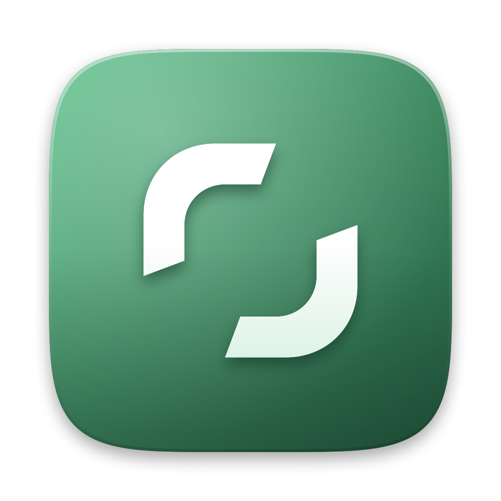
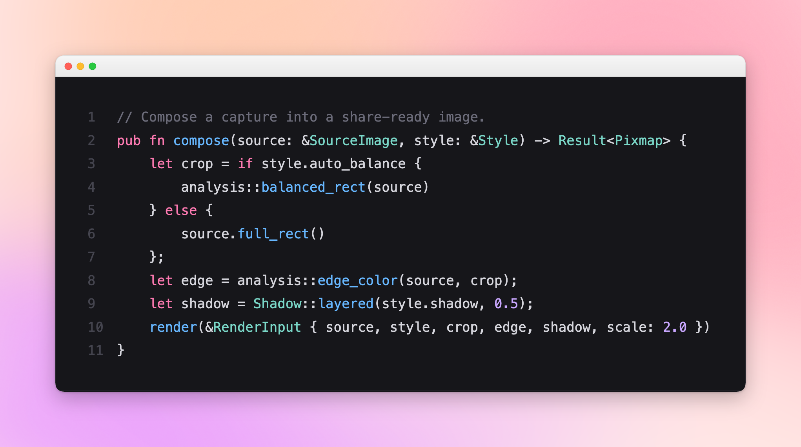

<div align="center">



# Kirei

**Beautiful, share-ready screenshots. One shortcut away.**

A native macOS app built in Rust with [GPUI](https://www.gpui.rs/) that frames your captures and redacts sensitive data before anything leaves your screen.


[Highlights](#highlights) · [Installation](#installation) · [Shortcuts](#global-shortcuts) · [Editor](#editor) · [Privacy](#privacy) · [Architecture](#architecture) · [Development](#development) · [Roadmap](#roadmap) · [Contributing](#contributing) · [License](#license)

<br>



</div>

---

## Overview

Kirei (綺麗, Japanese for "beautiful") turns an ordinary screenshot into an image ready for a post, a doc or a slide. Capture once, and Kirei applies the background, frame, shadow and rounded corners for you. It also masks emails, phone numbers, card numbers, CPF/CNPJ and API keys before you share.

Kirei lives in the menu bar, responds to global shortcuts and runs entirely on your Mac. No account, no server, no data ever leaves your machine.

## Highlights

| | |
|---|---|
| **Every kind of capture** | Area, window, full screen, scrolling capture, screen recording (MP4/GIF) and OCR straight to the clipboard. |
| **Automatic composition** | Auto-balance, 27 procedural backgrounds, window and browser frames, a two-layer shadow and continuous (squircle) corners. |
| **Sensitive data redaction** | On-device OCR with Apple Vision detects emails, phone numbers, credit cards (Luhn-validated), CPF, CNPJ, IP addresses, API keys and JWTs. |
| **Annotations** | Arrow, rectangle, ellipse, highlighter, text, numbered counter, pixelate, blur and crop, with smart alignment guides. |
| **Fast workflow** | Floating thumbnail, instant ⌘C, pin-to-screen and a 14-day capture history. |
| **Native to macOS** | ScreenCaptureKit, Vision, trackpad haptics and a fully localized interface in three languages. Architected to reach Windows and Linux. |

## Requirements

- macOS 14 Sonoma or later. Screen recording requires macOS 15.
- To build: [Rust](https://rustup.rs) and the Xcode Command Line Tools (`xcode-select --install`). A full Xcode install is not required.
- **Screen & System Audio Recording** permission.

## Installation

### Build from source

No Apple Developer account or full Xcode install required.

```bash
git clone https://github.com/shiddo-tech/kirei.git
cd kirei
scripts/bundle-macos.sh --install
```

| Command | What it does |
|---|---|
| `scripts/bundle-macos.sh` | Debug build, bundled as `target/debug/Kirei.app` |
| `scripts/bundle-macos.sh --release` | Release build, bundled as `target/release/Kirei.app` |
| `scripts/bundle-macos.sh --install` | Release build, signed and copied to `/Applications` |

The first build takes a few minutes while GPUI compiles. Subsequent builds are incremental.

### First launch

1. Open Kirei. The onboarding walks you through the app and its shortcuts.
2. On your first capture, grant access in **System Settings › Privacy & Security › Screen & System Audio Recording**.
3. Relaunch the app.

### Local code signing and permissions

`bundle-macos.sh` signs the app with a local certificate named **Kirei Local Signing**, stored in your login keychain. This keeps the app's identity stable across builds, so the Screen Recording permission survives every recompile.

Without the certificate, the build falls back to ad-hoc signing and macOS asks for permission again after each build. Ad-hoc signing is fine if you build once and use the app. The certificate only matters if you rebuild often.

To create the certificate (one-time setup):

1. Open **Keychain Access** and choose **Keychain Access › Certificate Assistant › Create a Certificate…**.
2. For **Name**, enter exactly `Kirei Local Signing`.
3. For **Identity Type**, choose **Self-Signed Root**. For **Certificate Type**, choose **Code Signing**.
4. Click **Create**. The next run of `bundle-macos.sh` picks it up automatically.

To remove it later: **Keychain Access › login › My Certificates › "Kirei Local Signing"**.

## Global shortcuts

Every shortcut can be remapped in **Settings**.

| Shortcut | Action |
|---|---|
| <kbd>⌥</kbd><kbd>⇧</kbd><kbd>1</kbd> | Capture area. Drag to select; press Space or click to pick a window; Esc cancels. |
| <kbd>⌥</kbd><kbd>⇧</kbd><kbd>2</kbd> | Capture window |
| <kbd>⌥</kbd><kbd>⇧</kbd><kbd>3</kbd> | Capture the screen under the pointer |
| <kbd>⌥</kbd><kbd>⇧</kbd><kbd>4</kbd> | Capture text (OCR straight to the clipboard) |
| <kbd>⌥</kbd><kbd>⇧</kbd><kbd>5</kbd> | Edit the image on the clipboard |
| <kbd>⌥</kbd><kbd>⇧</kbd><kbd>6</kbd> | Record the screen (area or window). Press again to stop. |
| <kbd>⌥</kbd><kbd>⇧</kbd><kbd>7</kbd> | Scrolling capture: select an area, then scroll down slowly |

**Settings › General › Capture** adds a self-timer (3, 5 or 10 s; click the countdown to cancel) and an option to hide desktop icons.

During area selection, a magnifier shows the pixels around the cursor along with exact coordinates.

## After capture

By default, a **floating thumbnail** appears in the corner of the screen. Drag it into any app, copy it, save it or open the editor (button or double-click). It dismisses itself after 7 s and stays put while the pointer hovers over it. In **Settings › General** you can switch this to "Open the editor" or copy directly.

Each capture comes with a flash and Kirei's signature sound: by default, a soft voice saying "kirei" (`Resources/kirei-voice.wav`). Prefer a classic shutter? Switch it in **Settings › General**. All other sounds are synthesized in-app. The image then glides into the thumbnail.

- **Instant ⌘C**: while the thumbnail is on screen, ⌘C copies the capture, even when another app is in front. Once the thumbnail is gone, ⌘C goes back to normal in other apps. ⌘C also copies from the editor and from pinned images.
- **Pin to Screen**: from the thumbnail, the editor (⌘P) or the history. The image floats above everything. Drag to move, scroll or pinch to resize, double-click to edit, and right-click for opacity and click-through. Esc closes it; pinned images can also be closed from the menu bar.
- **Capture History**: menu bar › Capture History… (⌘Y in the app). Originals from the last 14 days (up to 60) are kept in `~/Library/Application Support/Kirei/History`. Can be turned off in Settings.
- **Screen recording** (macOS 15 or later): records MP4 (H.264, 60 fps, cursor included). When you stop, the thumbnail lets you save as MP4, save as GIF (12 fps, up to 960 px) or copy. While recording, the menu bar icon becomes a stop button.

## Editor

### Composition

- **Auto-balance**: trims uniform borders and centers the content.
- **Background**: the Art tab offers 27 procedural backgrounds (mesh, linear and radial gradients, blended in OKLab). **Vary** keeps the palette and generates new shapes. Also available: solid colors, a custom color, an image, your wallpaper or transparency, with optional grain.
- **Frame**: macOS window or browser chrome, light or dark, plus a corner signature (@yourname).
- **Layout**: padding, inset (filled with the edge color), corner radius, shadow, aspect ratio (1:1, 4:3, 16:9, 9:16, 4:5…) and 3×3 positioning.
- **Hairline border**: a half-point stroke separates the capture from the background (can be disabled under Layout). Corners are continuous (squircle) and the shadow has two layers: a tight contact shadow and a soft ambient one.

### Annotations

Arrow, rectangle, ellipse, highlighter, text, numbered counter, pixelate, blur and crop.

- **Selection**: click, ⇧-click, drag a marquee or press ⌘A.
- **Editing**: move, resize by the corners (text included), double-click to edit text, duplicate (⌘D or ⌥-drag), bring forward or send backward, delete (⌫), change color and stroke width, undo and redo.
- With a drawing tool active, dragging an existing object's edge moves it. Right-click opens the object's context menu.
- **Counter**: double-click to edit the number. A number restarts the sequence from that value. Text (a single letter, for example) is displayed without consuming a number. Clear the value to return to automatic numbering.
- **Alignment guides**: annotations snap to the center and edges of the capture and of other annotations, with trackpad haptic feedback. Hold ⌘ to move freely.

### Text and sensitive data

- **Hide sensitive data**: on-device OCR (Vision) detects emails, phone numbers, credit cards (Luhn), CPF, CNPJ, IP addresses, API keys and JWTs, and pixelates every match.
- **Copy Text (OCR)**: extracts all text from the image.

### Export and styles

- **Export**: copy (⌘C), save to the default folder (⌘S), save as PNG, JPEG or HEIC (⇧⌘S), drag into other apps, or share. A Settings option exports at @1x.
- **Saved styles**: thumbnail cards in the inspector. Right-click to update or delete. The last style used becomes the default.

### Interface

Related tools share a single button (rectangle/ellipse, pixelate/blur). Click the active button again to switch, or right-click it. Color and stroke width live in a single swatch that only appears when a drawing tool or annotation is selected.

In the inspector, the Frame, Layout and Advanced sections (signature, inset, angle, grain and hairline border) are collapsible and remember their state. Backgrounds show a single row with **Show More**. Restore Default and Shortcuts are in the ⋯ menu.

### Editor keys

| Key | Action |
|---|---|
| <kbd>V</kbd> <kbd>A</kbd> <kbd>R</kbd> <kbd>O</kbd> <kbd>H</kbd> <kbd>T</kbd> <kbd>N</kbd> <kbd>P</kbd> <kbd>B</kbd> <kbd>C</kbd> | Tools |
| <kbd>⌫</kbd> | Delete selection |
| <kbd>←</kbd> <kbd>→</kbd> <kbd>↑</kbd> <kbd>↓</kbd> | Nudge 1 px (10 px with <kbd>⇧</kbd>) |
| <kbd>Esc</kbd> | Deselect |
| <kbd>⌘</kbd><kbd>C</kbd> / <kbd>⌘</kbd><kbd>S</kbd> / <kbd>⇧</kbd><kbd>⌘</kbd><kbd>S</kbd> | Copy / Save / Save As |
| <kbd>⌘</kbd><kbd>D</kbd> | Duplicate |
| <kbd>⌘</kbd><kbd>P</kbd> | Pin to Screen |

## Privacy

- **Fully local.** Kirei makes no network requests. OCR and sensitive-data detection run on your Mac using Apple's Vision framework.
- **History you control.** Stored in `~/Library/Application Support/Kirei/History`, expires after 14 days (60 items max) and can be turned off in Settings.
- **Local diagnostics.** Crash reports are written to `~/Library/Logs/Kirei` and never sent anywhere.

> [!IMPORTANT]
> Automatic redaction relies on OCR and pattern matching. It greatly reduces risk, but it is not a substitute for a final review before you share an image.

## Architecture

Kirei is a single Rust crate with a [GPUI](https://www.gpui.rs/) interface, the UI framework behind the Zed editor. `scripts/bundle-macos.sh` wraps the binary in a `.app` bundle (Info.plist and icon). Translations and the "kirei" voice are embedded in the binary. The app runs as a menu bar agent (`LSUIElement`); its Dock icon appears only while a window is open.

Capture and OS integrations are isolated in `src/capture` and `src/platform`. Everything else is platform-agnostic. Porting Kirei to Windows or Linux means implementing those modules for the new OS; the interface stays the same.

```
kirei/
├── Cargo.toml
├── build.rs                 # Links the Swift libraries used by the screencapturekit crate
├── src/
│   ├── main.rs              # Entry point and test modes
│   ├── shell.rs             # Menu bar, shortcuts and app menus
│   ├── flow.rs              # What happens after each capture
│   ├── overlay.rs           # Area and window selection, with magnifier
│   ├── scrolling.rs         # Scrolling capture (UI)
│   ├── scroll.rs            # Stitching for scrolling captures
│   ├── recorder.rs          # Screen recording and GIF export
│   ├── editor/              # Editor: state, canvas, inspector and tests
│   ├── render/              # Composition (layout, backgrounds, shadow, text, blur)
│   ├── model.rs             # Style, background and annotations
│   ├── analysis.rs, ocr.rs  # Auto-balance, OCR and sensitive data
│   ├── thumbnail.rs         # Floating thumbnail
│   ├── pinned.rs            # Pinned images
│   ├── history*.rs          # History and its window
│   ├── settings*.rs         # Preferences and the Settings window
│   ├── welcome.rs           # Onboarding
│   ├── feedback.rs, flash.rs, countdown.rs, hud.rs
│   ├── l10n.rs              # l() function and language selection
│   ├── capture/             # Per-OS capture (macOS: ScreenCaptureKit)
│   ├── platform/            # macOS AppKit, global hotkeys, Vision, video and text
│   └── ui/                  # Theme, icons, controls and text input
├── assets/                  # App icon
├── Resources/               # "kirei" voice
├── Localization/            # en, pt-BR and es (.lproj)
└── scripts/bundle-macos.sh  # Build, signing and installation
```

## Development

```bash
cargo build                         # debug build
cargo test                          # model, localization, OCR, export, history and editor tests
scripts/bundle-macos.sh             # bundles target/debug/Kirei.app
```

> [!TIP]
> Always test capture and permissions with the `.app` bundle. Under `cargo run`, the Screen Recording permission is granted to your terminal, not to Kirei.

### Test modes

The binary includes headless modes with no menu bar and no global shortcuts:

```bash
kirei --render-test input.png output.png [style.json]     # apply a style to an image
kirei --scroll-test tall-image.png output.png             # simulate a scrolling capture
kirei --record-test output.mp4 [window-id]                # record 2 s of an area or window
kirei --gif-test video.mp4                                # generate a video's poster and GIF
kirei --edit image.png                                    # open the editor only
kirei --show settings|history|welcome|recording-controls  # open a single window
```

With `--edit` and `--show`, data is kept in a temporary folder and the app does not steal focus.

### Versioning

- The version lives in `Cargo.toml` (currently `1.2.0`) and is written to the Info.plist.
- The bundle identifier is `com.shiddo.kirei`.

### Localization

Kirei ships in English, Portuguese (Brazil) and Spanish. It follows the macOS language by default and can be changed in **Settings › General › Language** (requires a restart).

- In code, strings use `l("English text")`. The English text is the key itself, so any missing translation falls back to English.
- Translations live in `Localization/<language>.lproj/Localizable.strings` and are embedded in the binary.

To add a language, create `Localization/<language>.lproj` with the same keys and register the language in `src/l10n.rs`.

## Roadmap

- Signed and notarized DMG for distribution beyond local builds.
- Localized bundle metadata and a build number in the Info.plist (currently version only).
- Screen recording on macOS 14 (Kirei uses `SCRecordingOutput`, available from macOS 15).
- Windows and Linux support.

## Contributing

Contributions are welcome: bug fixes, translations, ideas and bug reports. Please read [CONTRIBUTING.md](CONTRIBUTING.md) before opening a pull request.

To report a bug, use the [issue templates](https://github.com/shiddo-tech/kirei/issues/new/choose). If the app crashed, attach the reports from `~/Library/Logs/Kirei`.

## License

Released under the [MIT License](LICENSE).

---

<div align="center">

**Kirei** is an open-source project by **Shiddo**.<br>
© 2026 Shiddo. Released under the MIT License.

</div>
